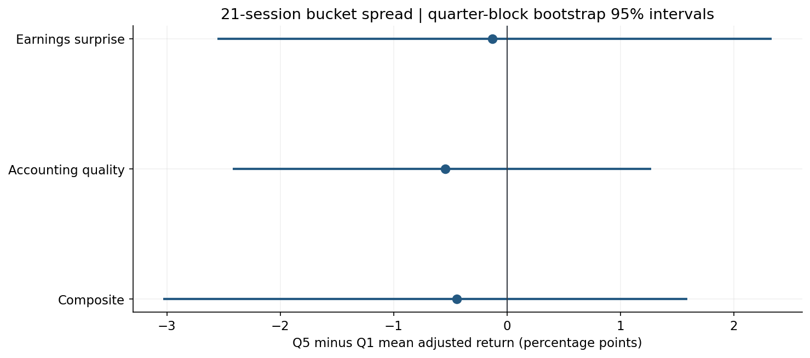
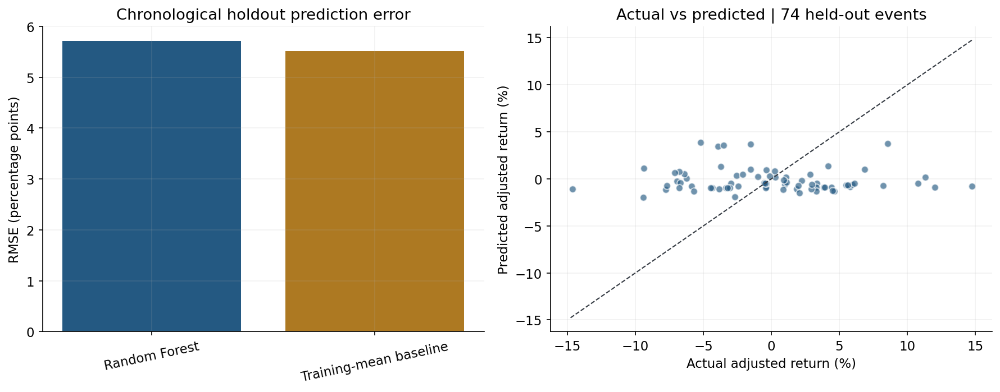

# Financial Statement Quality & Earnings Surprise Model

**Vicente Pozo | Academic empirical investment research | Python**

A completed retrospective study of accounting-quality measures, historical earnings surprises and
subsequent benchmark-adjusted stock returns. SEC EDGAR supplies filings; Yahoo Finance supplies historical
EPS estimates/reported EPS and adjusted prices. Developed with AI assistance.

## Start here

- [Executed notebook](notebooks/Financial_Statement_Quality_Earnings_Surprise_Model.ipynb): code, tables, six figures and generated conclusions.
- [Executed findings](docs/results/RESULTS.md): concise observed results and interpretation.
- [Methodology](docs/METHODOLOGY.md): timing, formulas and limitations.
- [Validation](docs/VALIDATION.md): calculation checks, source coverage and execution engine.
- [Data coverage](docs/results/data_coverage.csv) and [source provenance](docs/results/source_manifest.json).

## Observed results


**Executed sample:** 300 matched announcements from 15 companies; 2021-01-15 through 2025-11-20. All 300 matched events have 21-session outcomes.

**Holdout:** 225 training events after purge and 74 test events beginning 2024-10-16.

**Prediction check:** Random Forest RMSE = 5.72 percentage points; training-mean baseline = 5.51 pp. Forest error is higher; holdout R² = -0.082.

**Earnings surprise:** 21-session Q5−Q1 spread -0.13 pp (quarter-block bootstrap 95% interval -2.55 to +2.33 pp; Q5 n=48, Q1 n=66).

**Accounting quality:** 21-session Q5−Q1 spread -0.54 pp (quarter-block bootstrap 95% interval -2.42 to +1.27 pp; Q5 n=58, Q1 n=56).

**Composite:** 21-session Q5−Q1 spread -0.44 pp (quarter-block bootstrap 95% interval -3.03 to +1.59 pp; Q5 n=57, Q1 n=62).

**Interpretation:** findings describe this retrospective sample. Provider estimate vintages, survivor selection, sector differences and dependent observations prevent stronger forecasting or investment-performance claims.






## Fixed scope

- Original 15-company convenience sample: AAPL, MSFT, AMZN, GOOGL, META, NVDA, JPM, JNJ, PG, KO, XOM, CVX, WMT, HD, CAT.
- Announcements: 2021-01-01 through 2025-12-31; SEC filing window: 2019–2025.
- Price window: 2020-01-01 to 2026-02-15 exclusive, including a forward-outcome buffer.
- Primary outcome: 21 trading sessions; 1- and 5-session outcomes are descriptive checks.
- Fixed 50/50 composite and fixed Random Forest settings; no test-set tuning.
- Prespecified sensitivity excludes JPM and rebuilds quality ranks and historical thresholds.

## Run locally

Python 3.12, from the repository root:

```bash
python -m venv .venv
source .venv/bin/activate
python -m pip install -r requirements.txt
python -m unittest discover -s tests -v
python scripts/execute_notebook.py notebooks/Financial_Statement_Quality_Earnings_Surprise_Model.ipynb
```

Alternatively open the notebook in Jupyter and run every cell in order. The `src` folder must be
present beside `notebooks`. The default SEC User-Agent identifies this public academic project by
its repository URL; an optional `SEC_USER_AGENT` environment setting is never committed. Raw caches
are reused until explicitly refreshed. Respect provider access policies and stop after a denial or rate limit.

## Reproducibility and data rights

Downloads are cached locally in `data/real_snapshot_20261019/` with retrieval timestamps and hashes.
Raw prices and vendor EPS records, full event-level panels, and local caches are excluded from public GitHub.
Derived aggregate findings, source provenance, code and saved notebook outputs are published.
Third-party data remain subject to provider terms; no redistribution license is granted here.

The S&P 500 price index is compared with adjusted stock prices, so dividend treatment is not perfectly
matched. The study is a retrospective association analysis, not a costed trading strategy. Historical
estimate vintages cannot be independently certified as pre-announcement archives.

## Technical references

- [SEC EDGAR APIs](https://www.sec.gov/search-filings/edgar-application-programming-interfaces)
- [SEC automated-access policy](https://www.sec.gov/search-filings/edgar-search-assistance/accessing-edgar-data)
- [yfinance earnings dates](https://ranaroussi.github.io/yfinance/reference/api/yfinance.Ticker.get_earnings_dates.html)
- [scikit-learn leakage guidance](https://scikit-learn.org/stable/common_pitfalls.html)

For efficient public rendering, the six original PNG figures are linked below their producing notebook cells rather than embedded as base64. Code, execution counts, tables and numerical results are unchanged. The delivered notebook has the figures embedded.
